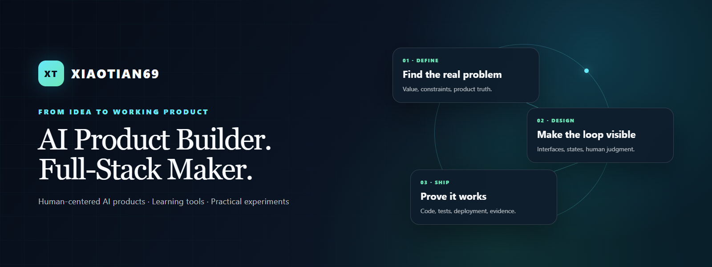

  <a href="#featured--代表作品">Featured</a> ·
  <a href="#all-projects--全部作品">All projects</a> ·
  <a href="#how-i-work--我的工作方式">How I work</a> ·
  <a href="#stack--技术栈">Stack</a>

**我把 AI 产品从问题定义一路做到可运行的软件：产品判断、交互设计和完整工程实现放在一起完成。**

I design and build AI-native products end to end — from framing the problem, to designing the interaction, to shipping working software with tests and a live deployment.

## Featured / 代表作品

### 🌉 [ModelingBridge · 模桥](https://github.com/Xiaotian69/modelingbridge) · [www.modelingbridge.cc](https://www.modelingbridge.cc)

数学建模学习平台：第零课入门、5 门互动精讲（线性规划、AHP、TOPSIS / 熵权法、回归、图论）、专项练习与七关综合实战。仓库为 V3.0 初期公开快照，最新进展以官网为准。 
*An interactive mathematical-modeling learning platform: guided lessons, hands-on labs, practice and quests.* · `React` `TypeScript` `Vite` `FastAPI`

### 🌙 [Luna AI Companion](https://github.com/Xiaotian69/luna-ai-companion)

可自托管的单用户中文 AI 陪伴：流式对话、可查看和管理的长期记忆、自然语音，以及密码登录、限流与每日配额等安全与费用护栏。 
*A self-hostable Chinese AI companion with streaming chat, transparent long-term memory and natural voice.* · `React` `TypeScript` `Cloudflare Pages + D1`

### 📐 [Study Bench](https://github.com/Xiaotian69/study-bench) · [Live](https://study-bench.vercel.app)

AI 辅助的数学分析学习工作台：按教材结构组织知识点，讲义、公式与图示、题目练习和 AI 评阅反馈在同一个工作区完成（自备模型密钥）。 
*An AI-assisted Math Analysis workbench: lessons, KaTeX, diagrams, practice and bring-your-own-key AI feedback.* · `Next.js` `React` `KaTeX`

### 💰 [Cash · 个人资产管家](https://github.com/Xiaotian69/cash) · [Download v1.0](https://github.com/Xiaotian69/cash/releases/tag/v1.0.0)

本地优先的 Windows 资产管理与轻量记账工具：资产总览、收支记录、余额联动、趋势图表与 JSON 备份，无需注册、不联网同步。 
*A local-first personal asset and expense tracker for Windows.* · `Tauri 2` `React` `TypeScript`

### 📍 [CxSign](https://github.com/Xiaotian69/CampusSign) · [Releases](https://github.com/Xiaotian69/CampusSign/releases/latest)

学习通（超星）位置签到 Windows 图形界面工具：选择账号与地点后由用户手动发起签到并逐项反馈结果，支持多账号、自定义地点与导入导出，配置仅保存在本机。 
*A Windows GUI tool for Chaoxing location check-ins, with multi-account support and customizable places.* · `Python` `Desktop`

### 🧭 [Anker AI Native Product Lab](https://github.com/Xiaotian69/anker-ai-native-product-lab) · [Live](https://xiaotian69.github.io/anker-ai-native-product-lab/)

独立参赛作品：用证据卡、多角色 AI 评审和可审计的决策账本做 AI 原生的产品定义；产品概念与用户假设均待真实验证，与安克无隶属关系。 
*An independent competition entry on AI-native product definition, with a replayable AI run and pre-registered validation.* · `React` `TypeScript` `Python`

## All projects / 全部作品

| Project | What it is / 定位 | Links |
| --- | --- | --- |
| [Python Exam Practice](https://github.com/Xiaotian69/python-exam-practice) | 浏览器里的 Python 151 题练习，代码题由 Pyodide 在本地运行 / 151-question practice with in-browser Python | [Live](https://xiaotian69.github.io/python-exam-practice/) |
| [Mystic Destiny · 命理星象](https://github.com/Xiaotian69/mystic-destiny) | 东方命理、塔罗与星座的沉浸式 H5，可选 AI 解读（娱乐用途）/ Immersive astrology & tarot H5 | [Live](https://xiaotian69.github.io/mystic-destiny/) |
| [PanelPick · 勾选拆图](https://github.com/Xiaotian69/checked-collage-panel-extractor) | 识别联系表上的勾选标记，从干净原图精准导出选中格子；附 Agent Skill / Checked-panel extractor CLI + Agent Skill | — |
| [Pet Society Preview · 宠物社](https://github.com/Xiaotian69/pet-society-preview) | 宠物日常照护记录与症状观察流程的网页演示，AI 尚未接入 / Pet-care logging demo, no AI connected | [Live](https://xiaotian69.github.io/pet-society-preview/) |
| [Shanxi Caijing Exams](https://github.com/Xiaotian69/shanxi-caijing-exams) | 山西财经大学期末资料的分类索引与校验清单 / Indexed study-material archive with a manifest | — |
| [Unipus Popup Clicker](https://github.com/Xiaotian69/unipus-popup-clicker) | 本地 Playwright 小工具，自动确认常规通知弹窗 / Local Playwright helper for routine dialogs | — |

## How I work / 我的工作方式

- **先确认产品事实** — 区分已实现能力与设想，再提炼清楚的价值主张。 *Start with the product truth: separate what works from what is planned.*
- **交付真实界面** — 优先做可运行的流程和有代表性的产品状态。 *Build the real interface, not concept-only mockups.*
- **把边界也设计进去** — 隐私、密钥、本地数据、AI 回退与人工确认都是产品的一部分。 *Design the boundaries: privacy, credentials, local data, AI fallbacks, human confirmation.*
- **展示前先验证** — 用测试、构建、链接检查、截图与部署检查支撑每一条描述。 *Verify before presenting: tests, builds, link checks and deployments back the claims.*

## Stack / 技术栈

`TypeScript` · `React` · `Next.js` · `Vite` · `Tauri` · `Python` · `FastAPI` · `Cloudflare Workers / Pages / D1` · `Vercel` · `GitHub Actions` · `Playwright` · `Vitest` · `pytest`

Building practical AI products, one verified loop at a time. / 持续把 AI 想法做成可验证、可使用的产品。

